<p align="center">
  <picture>
    <source media="(prefers-color-scheme: dark)" srcset="assets/readme/banner-dark.svg">
    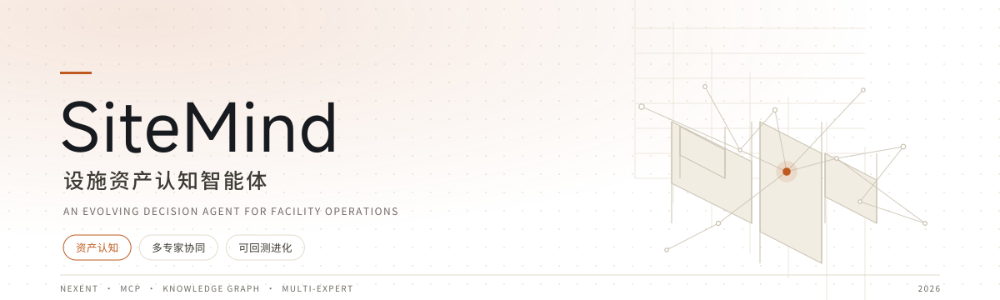
  </picture>
</p>

<h3 align="center">把低价值资料转化成知识，让知识落到决策，而决策立刻变成动作</h3>

<p align="center">资产认知　·　多专家协同　·　可回测进化</p>

<p align="center">
<a href="#亮点"><picture><source media="(prefers-color-scheme: dark)" srcset="assets/readme/nav/nav-highlights-dark.svg"></picture></a>&nbsp;&nbsp;<a href="#系统概览"><picture><source media="(prefers-color-scheme: dark)" srcset="assets/readme/nav/nav-overview-dark.svg"></picture></a>&nbsp;&nbsp;<a href="#关键设计"><picture><source media="(prefers-color-scheme: dark)" srcset="assets/readme/nav/nav-design-dark.svg"></picture></a>&nbsp;&nbsp;<a href="#从演示到现场"><picture><source media="(prefers-color-scheme: dark)" srcset="assets/readme/nav/nav-field-dark.svg"></picture></a>&nbsp;&nbsp;<a href="#快速开始"><picture><source media="(prefers-color-scheme: dark)" srcset="assets/readme/nav/nav-start-dark.svg"></picture></a>&nbsp;&nbsp;<a href="#平台能力与致谢"><picture><source media="(prefers-color-scheme: dark)" srcset="assets/readme/nav/nav-credits-dark.svg"></picture></a>
</p>

<p align="center">
  <a href="https://github.com/ModelEngine-Group/nexent"></a>
  
  
  
  
</p>

<p align="center">
  <a href="https://sitemind-486cn1yd59z.qoder.zone"><picture><source media="(prefers-color-scheme: dark)" srcset="assets/readme/chips/cta-demo-dark.svg"></picture></a>
</p>

<br>

厂区的设备手册、维保规程、分时电价政策和多年历史工单长期散落在共享盘与档案柜中；当负荷突增、电梯拥堵或设备故障发生时，值班人员仍只能凭经验临场判断。

**SiteMind 先把这些资料读成带版本的知识**——识别、入图、抽成可执行规则，支持回滚；**再由一个主 Agent 带多位专家**并行研判、协商调度。

每个动作都能点开查看原文依据、图谱路径与当时的知识版本；调度效果由独立电量账本算出，不靠模型自述。

<p align="center">
  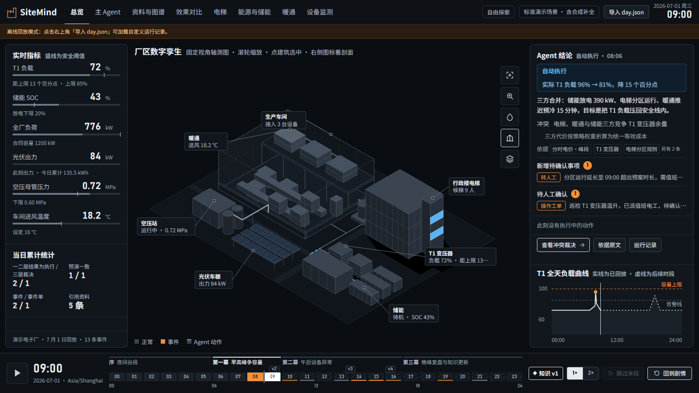
</p>
<p align="center"><sub>左栏为实时指标与限值，中栏是 3D 厂区，右栏为结论与待办，底部是播放条与知识版本。</sub></p>

## 亮点

<table>
<tr>
<td width="33%" valign="top"><b>把一切变为数据</b><br><br>把角落里的设备数据与重复工单收集入图，形成可迭代的知识库；版本可回滚，改动可追溯到原文。</td>
<td width="33%" valign="top"><b>一个主 Agent，多位专家</b><br><br>多位专家按场景装配、独立运行并隔离知识库；常规走快通道直派，复杂事件交主 Agent 自主调查会诊。</td>
<td width="33%" valign="top"><b>一次前向完成多选判别</b><br><br>Jev 单次请求返回全部候选概率分布，约 78 毫秒；三种顺序取平均，再与向量召回首选一致才接纳。</td>
</tr>
<tr>
<td width="33%" valign="top"><b>三层裁决化解冲突</b><br><br>多专业争资源按三层裁决：安全一票否决 → 统一量纲加权优化 → 主 Agent 裁定，动作绑定原文证据。</td>
<td width="33%" valign="top"><b>先校验读数，再做决策</b><br><br>五类传感器故障单独建模；残差列出候选假设，Agent 主动试探排除，读数异常时切虚拟读数不停机。</td>
<td width="33%" valign="top"><b>每次进化都先回测验证</b><br><br>候选规则与权重先经历史场景回测、人工确认后发布，不佳可回滚；执行权限按 L0–L3 动态升降。</td>
</tr>
</table>

## 系统概览

实时工作台连着 Nexent 在线运行，回放展示页用于运维复盘；两边共用同一份运行记录。

<table>
  <tr>
    <td width="50%">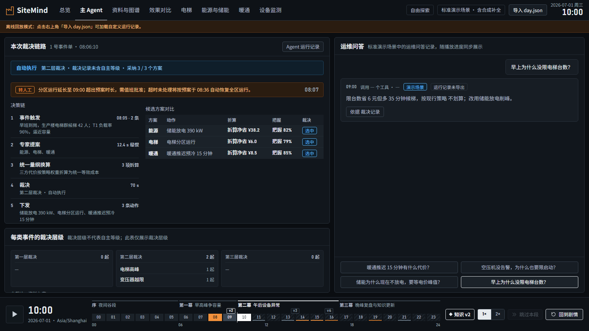<br><sub><b>冲突 · 换算 · 裁决</b> —— 三方争夺 T1 余量：候选方案按统一权折算净收益，逐项裁决并写下发动作。</sub></td>
    <td width="50%">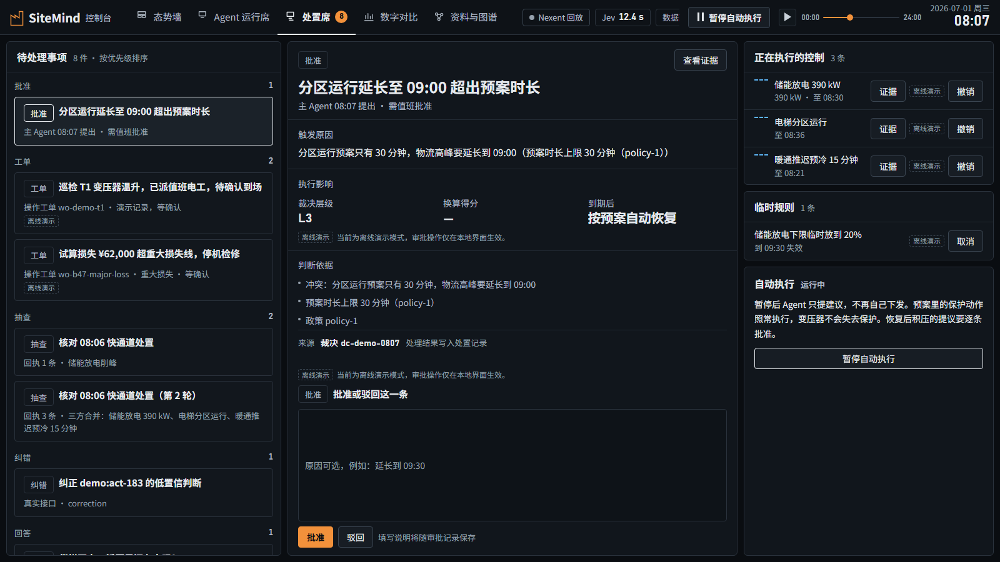<br><sub><b>处置席</b> —— 待批事项、操作工单、抽查、发布与在执控制集中排布，人可随时接管或撤销。</sub></td>
  </tr>
  <tr>
    <td width="50%">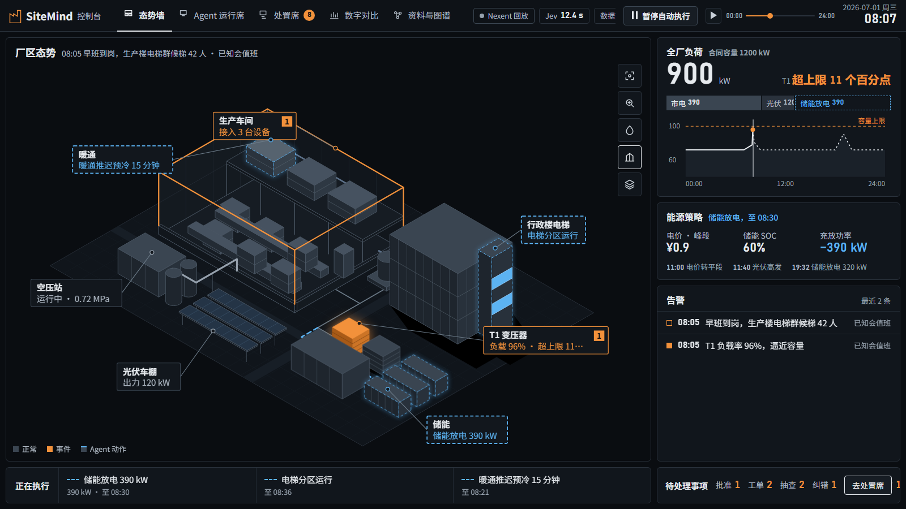<br><sub><b>态势大屏</b> —— 3D 厂区上的实时事件、全厂负荷与变压器负载、告警和正在执行的控制同屏可见。</sub></td>
    <td width="50%">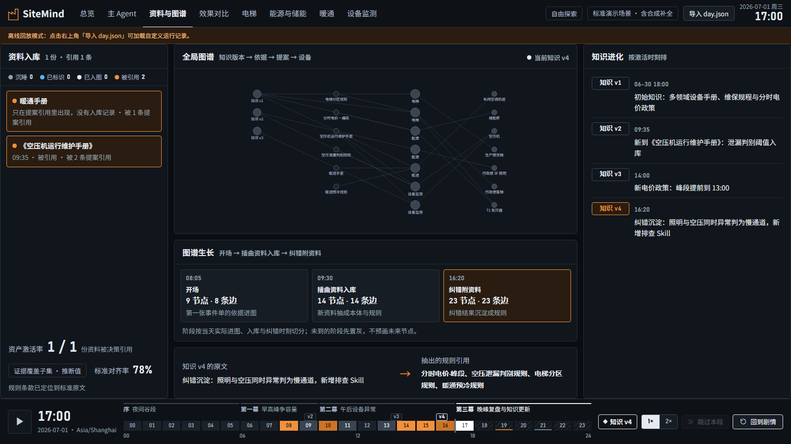<br><sub><b>资料与图谱</b> —— 拖入设备手册后实时解析并构建图谱节点，新增节点与边均可点开回看原文。</sub></td>
  </tr>
</table>

## 快速开始

### 在线体验

<p align="center"><a href="https://sitemind-486cn1yd59z.qoder.zone"><picture><source media="(prefers-color-scheme: dark)" srcset="assets/readme/chips/cta-demo-dark.svg"></picture></a></p>
<p align="center">
  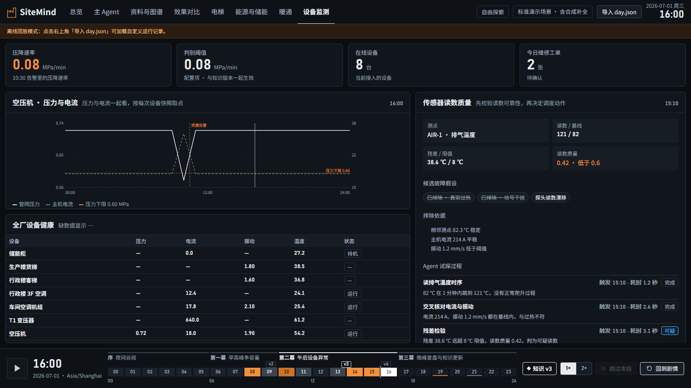
</p>
<p align="center"><sub>单文件离线回放页，底部播放条可跳任一小时，顶部八个标签页分别查看各视角。</sub></p>

### 本地运行

环境要求：Python 3.11–3.12。

```bash
pip install -e ".[storage,dev]"

python -m plantkg --profile mock --dry-run   # 装配并打印健康状态与已登记的工具
python -m pytest -q                          # 全量测试
```

离线运行完整工厂场景（无需模型与 Nexent）：

```bash
python scripts/demo_factory.py --mode offline --out runtime/factory-demo
```

运行后会生成两日的 `day.json`、运行轨迹与三组对照评测结果。构建静态回放页即可导入离线重放：

```bash
cd web
npm ci
npm run build:showcase        # 产出 web/dist-showcase/index.html（单文件，可直接双击打开）
```

接入 Nexent 跑真实模型（可选）：

<details>
<summary>本地部署 Nexent v2.8.2，并导入主 Agent 与多位专家的配置</summary>

```bash
git clone --depth 1 --branch v2.8.2 https://github.com/ModelEngine-Group/nexent.git nexent
cd nexent && bash deploy.sh docker --components infrastructure,application,data-process,supabase \
  --port-policy development --image-source general
```

部署完成后访问 `http://localhost:3000`，按以下配置与清单导入：

<p align="center"><a href="nexent_assets/agents/README.md"><picture><source media="(prefers-color-scheme: dark)" srcset="assets/readme/chips/doc-agents-dark.svg"></picture></a> <a href="nexent_assets/skills"><picture><source media="(prefers-color-scheme: dark)" srcset="assets/readme/chips/doc-skills-dark.svg"></picture></a> <a href="nexent_assets/knowledge/README.md"><picture><source media="(prefers-color-scheme: dark)" srcset="assets/readme/chips/doc-kn-dark.svg"></picture></a></p>

</details>

## 运行机制

值守程序管准入与派发，Agent 管调查与协商；每一步判断都落库留痕、可回溯。

<p align="center">
  <picture>
    <source media="(prefers-color-scheme: dark)" srcset="assets/readme/architecture-dark.svg">
    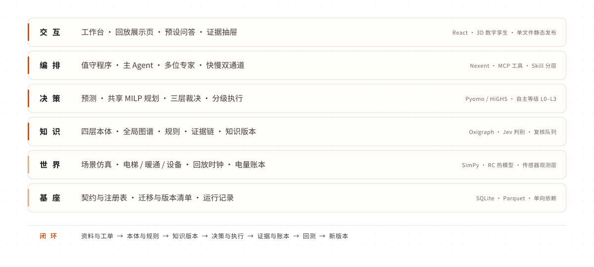
  </picture>
</p>

一次事件从进入到执行，经过六个环节：

<p align="center">
  <picture>
    <source media="(prefers-color-scheme: dark)" srcset="assets/readme/flow-dark.svg">
    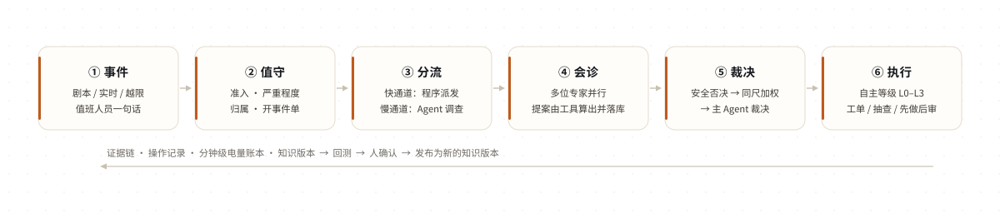
  </picture>
</p>

- **快通道**：命中已发布规则且判别放行时，程序沿图谱直接派发，不唤醒主 Agent。
- **慢通道**：遇到新事件、方案冲突或判别不确定时，主 Agent 调用工具自主调查并指定专家；有效判断沉淀回快通道。

## 关键设计

按“知识构建 → 检索与推理 → 判别门控 → 双层编排 → 工程保障 → 能力沉淀”展开核心设计。

### 知识构建：从资料到版本化本体

资料入库沿用与决策侧一致的思路：**常规走流程，例外交 Agent，经验回流程**。

<p align="center">
  <picture>
    <source media="(prefers-color-scheme: dark)" srcset="assets/readme/knowledge-stack-dark.svg">
    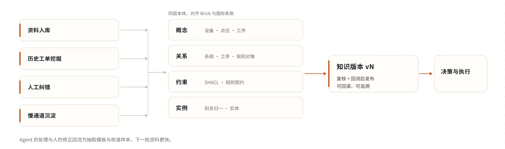
  </picture>
</p>

- 抽取结果落在概念、关系、约束、实例四层本体上，并与 Brick 及国标条款对齐；对不上的进复核队列，不静默丢弃。
- 历史工单按设备与故障现象聚类，Agent 解读高频聚类生成预警候选规则；“沉睡 → 已标识 → 已入图 → 被规则引用”全程可量化。

### 检索与推理：证据与计算分离

检索负责找原文证据，推理负责算影响面与代价；两边只读版本化知识，数值不经模型转述。

<p align="center">
  <picture>
    <source media="(prefers-color-scheme: dark)" srcset="assets/readme/drivers-dark.svg">
    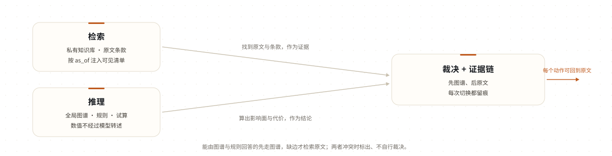
  </picture>
</p>

- **检索隔离**：网关每次运行注入该专家可见文档清单；漏注入即失败关闭，绝不退化成读全量资料。
- **冲突留痕**：能走图谱与规则的先走图谱，缺边再查原文；两者冲突时如实标出，切换记入证据链。

### Jev：一次前向给出所有选项的概率

判别不靠对话模型反复投票。百炼决策模型一次请求返回全部候选的概率分布：60 个选项约 1,000 token，服务端中位延迟约 **78 毫秒**；同一道题用对话模型投票 5 次需 4～14 秒。

<p align="center">
  <picture>
    <source media="(prefers-color-scheme: dark)" srcset="assets/readme/judge-dark.svg">
    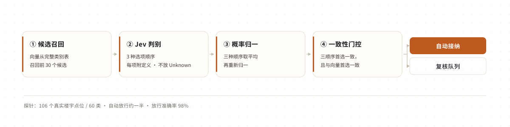
  </picture>
</p>

判别结果须过一致性门控：三种顺序的首选一致，且与向量召回首选一致，才自动接纳；否则进复核队列并展示前三名。在 106 个真实楼宇点位（60 类）的探针测试中，自动放行约一半、放行准确率达 98%；开集模拟（正确类别不在候选内）漏放约 11%，因此系统将候选召回与判别门控同等重视。它在系统里承担三项工作：为事件计算各领域概率（会诊权重）、给知识候选做判别门控、筛出需人工复核的条目。

<details>
<summary>查看 Jev 的三条实测硬要求与实验依据</summary>

| 要求 | 依据 |
| --- | --- |
| 不放 Unknown | 带 Unknown 时 41 次选它，39 次错误，且多为 0.8～0.96 高概率 |
| 多种选项顺序取平均 | 单一顺序首名命中仅 38%～49%，三种顺序平均升至 76%～78% |
| 每个选项附一句定义 | 只给类别名时 8/9 正确，补齐定义后达到 9/9 |

</details>

### Super-agent：双层编排的工程落地

这套双层编排从 DeepSeek《Super-agent 设计探索》出发，最核心的结论是“分工靠结构，不靠提示词”——单会话配子 Agent 工具在中性提示下，5 次运行无一委派。

<p align="center">
  <picture>
    <source media="(prefers-color-scheme: dark)" srcset="assets/readme/superagent-dark.svg">
    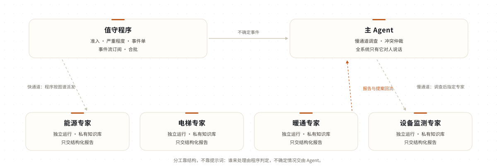
  </picture>
</p>

- **快慢双通道**：命中规则且判别明确的由程序派发；不确定事件交主 Agent 调查，有效经验回流为规则与 Skill。
- **事件流与预演**：按图谱拓扑划分事件流订阅；预演只作预判、到场按现场重算，统计一致率而不复用旧方案。
- **权限与安全**：按事件类别动态升降 L0–L3 自主等级；伤亡与重大损失触发安全标记兜底，Agent 只升不降。

### Harness：模型之外的工程保障层

模型之外的工程层负责工具暴露、上下文组织、运行收尾与写入把关，保障同一套提示词在线上稳定执行。

<p align="center">
  <picture>
    <source media="(prefers-color-scheme: dark)" srcset="assets/readme/harness-dark.svg">
    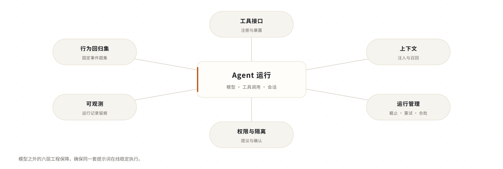
  </picture>
</p>

- **运行管理**：工具内 40 秒截止转后台任务；超时或断流重试一次后标“受阻”；运行绑定自动作废迟到结果。
- **权限与隔离**：网关签发身份并注入；写操作一律“Agent 提议、人确认”；专家按名隔离工具与知识库，漏配即失败关闭。
- **可观测与回归集**：`agent_runs` 逐条记耗时与终态；慢通道探针扩成 5～8 个固定事件回归集，改配置后重跑对比。

<p align="center">
  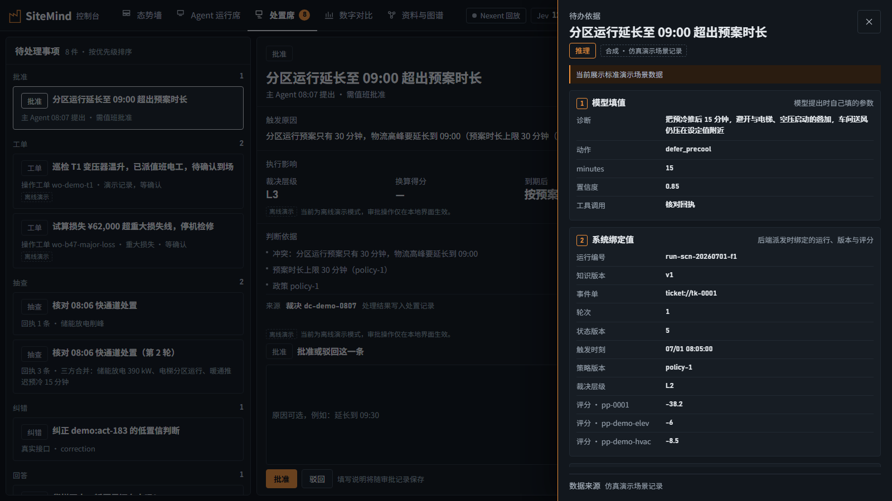
</p>
<p align="center"><sub>依据抽屉分区展示：模型填值、后端绑定运行与试算得分、判断依据与数据来源。</sub></p>

### 能力沉淀：换场景只换配置

领域包（专家、工具与私有知识库）、场景包（装配、剧本与优先级配置）以及四层 Skill（L1 工具用法 / L2 流程 / L2.5 领域要点 / L3 行业配置）全部落在配置层。切换行业或厂区时，主 Agent 与专家的底层框架保持不变。

## 从演示到现场

真实运行环境存在传感器异常、模型延迟波动、知识持续更新与设备状态不可控四类现实约束，SiteMind 将它们直接纳入主流程处理。

### 传感器读数可能异常

仿真环境中的读数默认完全真实，模型无需质疑输入；现实运行则可能出现卡死、漂移、掉线、跳变与偏置五类失真，因此系统将读数异常校验前置进决策流程：

<p align="center">
  <picture>
    <source media="(prefers-color-scheme: dark)" srcset="assets/readme/sensor-faults-dark.svg">
    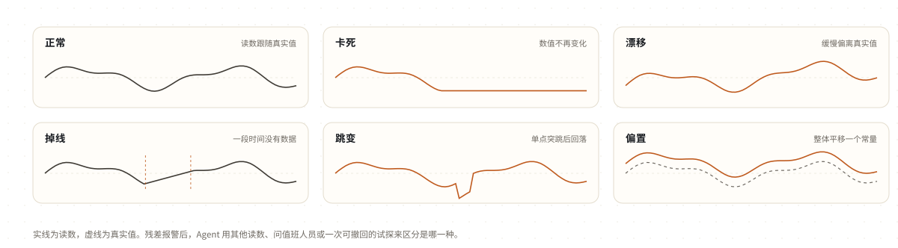
  </picture>
</p>

- 试探动作照常受自主等级约束；本轮调查结束后，时钟推进一个观察窗口，再带新读数接续排查。
- 安全底线不动摇：安全标记命中立即开操作工单；触发保护动作的读数带疑点时由 Agent 判断，超时无结论默认执行。

### 时间线与模型延迟解耦

模型响应快慢不应影响账本与决策结论。三条时间线共用同一套生效规则：

| 机制 | 做法 |
| --- | --- |
| 动作生效时刻 | 固定在 `trigger_at + response_budget`；预算取实测墙钟 p95 向上取整，写入版本策略 |
| live / trial / evaluation | 实跑停钟等待并按预算生效；回测不等墙钟；同一进程内实跑与回测互不干扰 |
| 迟到结果 | 运行、轮次或知识版本任一项不符，只记入历史，不执行也不回写 |

### 知识发布触发运行分叉

运行中途发布新知识版本时，系统在当前分钟分叉出子运行，完整保留原轨迹与分叉前状态：

<p align="center">
  <picture>
    <source media="(prefers-color-scheme: dark)" srcset="assets/readme/fork-dark.svg">
    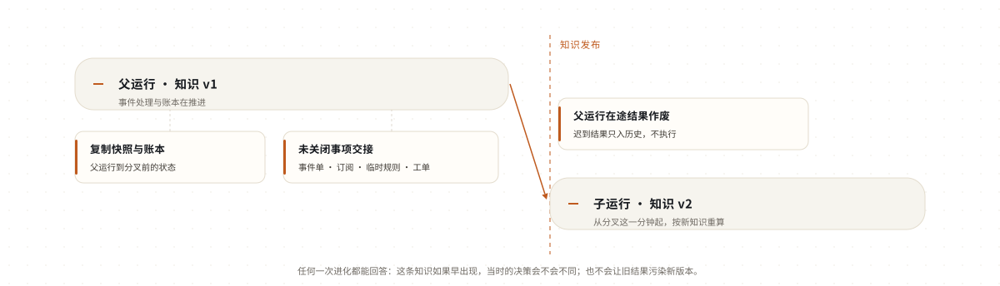
  </picture>
</p>

分叉前的快照与账本完整保留，未关闭的事件单与工单经钩子交接给子运行，父运行的在途结果自动作废，避免旧结论污染新版本。

### 计划与执行双账本核算

<p align="center">
  <picture>
    <source media="(prefers-color-scheme: dark)" srcset="assets/readme/ledgers-dark.svg">
    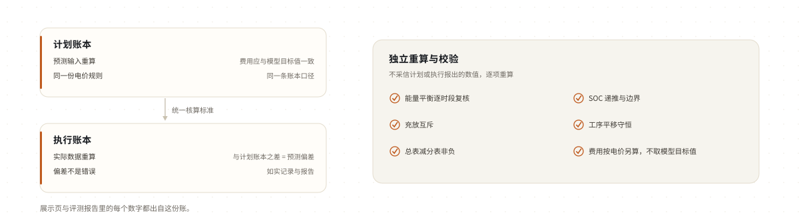
  </picture>
</p>

账本独立于优化变量逐项重算，费用按电价规则另算而不取模型目标值；展示页与评测报告里的每个数字都出自这份账。

## 评测与数据说明

<p align="center">
  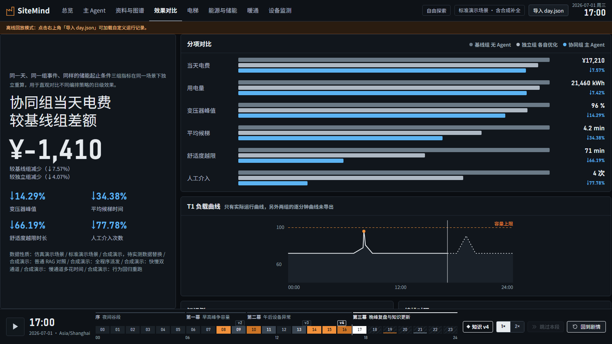
</p>
<p align="center"><sub>三组对照：同一天、同一事件流、同一储能起止条件，分项指标与 T1 负载曲线同屏；界面内已标注数据性质。</sub></p>

- **三组对照**：基线组（无 Agent）、独立组（各专家各自优化、不协同）、协同组（主 Agent 协同），同日、同事件流、同储能起止条件。
- **评测来源**：设备侧运行效果在完整厂区仿真场景中经独立电量账本检验；知识侧指标在真实公开数据集上实测（本体与规则抽取 F1、复核量–F1 曲线、跨文档多跳问答对照普通 RAG）。
- **客观核算**：全部指标由独立账本与评测模块直接算出；预演用于提前评估，事件到达后按当前状态重新求解。

<details>
<summary>查看数据性质五档标注与来源约定</summary>

- 每份数据均标明性质：`measured`（实测）、`derived`（公开数据推算）、`simulated`（仿真）、`synthetic`（按常理编写）、`configured`（配置）。
- 知识侧优先采用真实文本资料（设备手册、维保规程、国家标准、分时电价政策），设备运行侧通过厂区时序仿真驱动完整决策流程。
- 设备侧指标均为**厂区仿真场景下的运行检验结果**，知识侧指标均在真实公开数据集上实测。

</details>

## 工程文档与仓库结构

仓库内随附完整工程文档与模块化目录索引，按需展开查阅：

<details>
<summary>深入阅读：架构决策、账本、规划模型与评测方法（10 份文档）</summary>

<table>
<tr><th width="30%">文档</th><th>内容</th></tr>
<tr><td><a href="docs/architecture/adr"><picture><source media="(prefers-color-scheme: dark)" srcset="assets/readme/chips/doc-adr-dark.svg"></picture></a></td><td>规划模型、网关失败关闭、时间与可见性、运行标识、生命周期、后台任务、判别门控、求解校验</td></tr>
<tr><td><a href="docs/architecture/ledger.md"><picture><source media="(prefers-color-scheme: dark)" srcset="assets/readme/chips/doc-ledger-dark.svg"></picture></a></td><td>逐时段能量平衡、费用规则与守恒校验</td></tr>
<tr><td><a href="docs/architecture/planner.md"><picture><source media="(prefers-color-scheme: dark)" srcset="assets/readme/chips/doc-planner-dark.svg"></picture></a></td><td>共享 MILP 拼块式建模、求解与独立校验</td></tr>
<tr><td><a href="docs/architecture/storage.md"><picture><source media="(prefers-color-scheme: dark)" srcset="assets/readme/chips/doc-storage-dark.svg"></picture></a></td><td>SQLite、Oxigraph 与 Parquet 的分工及迁移</td></tr>
<tr><td><a href="docs/architecture/versions-runs.md"><picture><source media="(prefers-color-scheme: dark)" srcset="assets/readme/chips/doc-versions-dark.svg"></picture></a></td><td>不可变版本清单、运行记录与证据链结构</td></tr>
<tr><td><a href="docs/architecture/metrics.md"><picture><source media="(prefers-color-scheme: dark)" srcset="assets/readme/chips/doc-metrics-dark.svg"></picture></a></td><td>各项指标定义、计算方式、对照组与数据来源</td></tr>
<tr><td><a href="docs/integration/nexent-capability.md"><picture><source media="(prefers-color-scheme: dark)" srcset="assets/readme/chips/doc-nexent-cap-dark.svg"></picture></a></td><td>实测的 MCP、Skill、子 Agent 与平台运行约束</td></tr>
<tr><td><a href="docs/data"><picture><source media="(prefers-color-scheme: dark)" srcset="assets/readme/chips/doc-data-dark.svg"></picture></a></td><td>资料性质、时序说明、电价来源与 day.json 导出格式</td></tr>
<tr><td><a href="docs/experiments"><picture><source media="(prefers-color-scheme: dark)" srcset="assets/readme/chips/doc-experiments-dark.svg"></picture></a></td><td>本体与规则评测、三组场景对照的方法与结果</td></tr>
<tr><td><a href="docs/showcase/B49-回放展示页操作指南.md"><picture><source media="(prefers-color-scheme: dark)" srcset="assets/readme/chips/doc-showcase-dark.svg"></picture></a></td><td>播放条、证据抽屉与八个标签页的操作说明</td></tr>
</table>

</details>

<details>
<summary>仓库结构：查看 16 个核心包与目录分工</summary>

| 目录 | 内容 |
| --- | --- |
| `plantkg/core` | 契约、端口、注册表、时钟、版本清单与电量账本（跨包唯一接缝） |
| `plantkg/agent` | 值守程序、跨域会诊、三层裁决与分级执行 |
| `plantkg/experts` | 领域专家实现（演示场景含能源、电梯、暖通、设备监测） |
| `plantkg/knowledge` | 资产目录、四层本体、规则、全局图谱、证据链与判别后端 |
| `plantkg/decision` | 预测、共享 MILP 规划器、计划门控与人工确认 |
| `plantkg/world` | 场景仿真、传感器观测层、回放时钟与执行记录 |
| `plantkg/evolution` | 候选生成、历史回测与版本发布 / 回滚 |
| `plantkg/evaluation` | 三组对照与本体、规则评测 |
| `plantkg/integrations/nexent` | 网关、MCP 服务与 Agent 运行记录 |
| `plantkg/packs` | 光伏、储能、电价、生产、电梯、暖通、设备等领域包 |
| `contracts/` | 代码生成的 JSON Schema、OpenAPI、MCP 工具清单与事件约定 |
| `nexent_assets/` | 主 Agent 与专家配置、Skill、知识库清单与平台能力探针 |
| `web/` | 实时工作台与回放展示页（React + TypeScript） |
| `configs/`、`fixtures/` | 场地与场景配置、各领域包样例数据 |
| `scripts/` | 演示运行、数据下载与契约生成脚本 |
| `tests/` | 契约、单元、集成与演示验收测试 |

</details>

## 平台能力与致谢

Nexent v2.8.2 承接 Agent 运行、MCP 工具、Skill 与私有知识库；`plantkg` 承接值守、决策与执行。详细的平台能力适配与工程实践记录在下方文档：

<p align="center"><a href="docs/integration/nexent-capability.md"><picture><source media="(prefers-color-scheme: dark)" srcset="assets/readme/chips/doc-cap-record-dark.svg"></picture></a></p>

<p align="center">
  <picture>
    <source media="(prefers-color-scheme: dark)" srcset="assets/readme/ecosystem-dark.svg">
    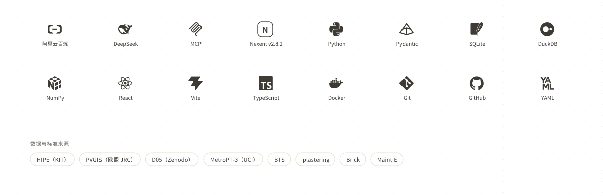
  </picture>
</p>

<details>
<summary>平台能力用法清单（7 项核心集成）</summary>

| 平台能力 | 本项目的用法 |
| --- | --- |
| 北向运行 API | 按事件单发起主 Agent 与专家独立运行，以 `complete` 信号拼接增量 |
| MCP 工具接入 | 注册表工具自动封装为 MCP 服务，统一使用 `plantkg_` 前缀 |
| `tool_params` 注入 | 网关签发短时效 `ctx` 并按 Agent 绑定核对，模型不可见也不可改 |
| Skill 分层 | 按 L1 工具 / L2 流程 / L2.5 领域 / L3 行业四层组织，随 Agent 导出 |
| 知识库 | 每位专家独立索引，按 `as_of` 注入可见清单；回放与评测关闭记忆 |
| 子 Agent | 主 Agent 绑定多位专家作为子 Agent，用于追问与问答 |
| 多模态 | 铭牌照片与光伏曲线由视觉模型转写为结构化描述后再入库 |

</details>

<details>
<summary>平台适配与工程实践</summary>

| 平台特性 | 工程适配 |
| --- | --- |
| MCP 单次调用 60 秒上限，超时后服务端仍空跑 | 工具内设 40 秒截止，超时返回 `pending` 与 `job_id` |
| 工具返回值超过 20,000 字符会被截断 | 单次结果控制在 8KB 以内，只回摘要与 ID 并支持分页 |
| 删除工具会导致绑定它的 Agent 无法运行 | 按“扫描 → 对比 → 解绑 → 重新发布”同步，先弃用后删除 |
| 记忆默认开启，易造成跨会话串扰 | 回放与评测使用记忆关闭的专用用户 |
| 知识库检索不支持范围条件过滤 | 按 `as_of` 预计算可见文档清单，每轮运行注入 |

</details>

### 致谢

<p align="center"><sub>平台与模型</sub></p>
<p align="center">
  <a href="https://github.com/ModelEngine-Group/nexent"><picture><source media="(prefers-color-scheme: dark)" srcset="assets/readme/chips/nexent-dark.svg"></picture></a>&nbsp;
  <a href="https://github.com/deepseek-ai"><picture><source media="(prefers-color-scheme: dark)" srcset="assets/readme/chips/deepseek-dark.svg"></picture></a>&nbsp;
  <a href="https://www.aliyun.com/product/bailian"><picture><source media="(prefers-color-scheme: dark)" srcset="assets/readme/chips/bailian-dark.svg"></picture></a>&nbsp;
  <a href="https://modelcontextprotocol.io"><picture><source media="(prefers-color-scheme: dark)" srcset="assets/readme/chips/mcp-dark.svg"></picture></a>
</p>

<p align="center"><sub>数据与标准</sub></p>
<p align="center">
  <a href="https://www.energystatusdata.kit.edu/hipe.php"><picture><source media="(prefers-color-scheme: dark)" srcset="assets/readme/chips/hipe-dark.svg"></picture></a>&nbsp;
  <a href="https://joint-research-centre.ec.europa.eu/photovoltaic-geographical-information-system-pvgis_en"><picture><source media="(prefers-color-scheme: dark)" srcset="assets/readme/chips/pvgis-dark.svg"></picture></a>&nbsp;
  <a href="https://zenodo.org/records/19180972"><picture><source media="(prefers-color-scheme: dark)" srcset="assets/readme/chips/d05-dark.svg"></picture></a>&nbsp;
  <a href="https://archive.ics.uci.edu/dataset/791/metropt+3+dataset"><picture><source media="(prefers-color-scheme: dark)" srcset="assets/readme/chips/metropt-3-dark.svg"></picture></a>&nbsp;
  <a href="https://github.com/cruiseresearchgroup/DIEF_BTS"><picture><source media="(prefers-color-scheme: dark)" srcset="assets/readme/chips/bts-dark.svg"></picture></a>&nbsp;
  <a href="https://github.com/plastering/plastering"><picture><source media="(prefers-color-scheme: dark)" srcset="assets/readme/chips/plastering-dark.svg"></picture></a>&nbsp;
  <a href="https://brickschema.org/"><picture><source media="(prefers-color-scheme: dark)" srcset="assets/readme/chips/brick-dark.svg"></picture></a>&nbsp;
  <a href="https://github.com/nlp-tlp/maintie"><picture><source media="(prefers-color-scheme: dark)" srcset="assets/readme/chips/maintie-dark.svg"></picture></a>
</p>

<p align="center"><sub>开源组件</sub></p>
<p align="center">
  <a href="https://www.python.org/"><picture><source media="(prefers-color-scheme: dark)" srcset="assets/readme/chips/python-dark.svg"></picture></a>&nbsp;
  <a href="https://github.com/Pyomo/pyomo"><picture><source media="(prefers-color-scheme: dark)" srcset="assets/readme/chips/pyomo-dark.svg"></picture></a>&nbsp;
  <a href="https://highs.dev/"><picture><source media="(prefers-color-scheme: dark)" srcset="assets/readme/chips/highs-dark.svg"></picture></a>&nbsp;
  <a href="https://github.com/oxigraph/oxigraph"><picture><source media="(prefers-color-scheme: dark)" srcset="assets/readme/chips/oxigraph-dark.svg"></picture></a>&nbsp;
  <a href="https://simpy.readthedocs.io/"><picture><source media="(prefers-color-scheme: dark)" srcset="assets/readme/chips/simpy-dark.svg"></picture></a>&nbsp;
  <a href="https://github.com/jlowin/fastmcp"><picture><source media="(prefers-color-scheme: dark)" srcset="assets/readme/chips/fastmcp-dark.svg"></picture></a>&nbsp;
  <a href="https://react.dev/"><picture><source media="(prefers-color-scheme: dark)" srcset="assets/readme/chips/react-dark.svg"></picture></a>&nbsp;
  <a href="https://vite.dev/"><picture><source media="(prefers-color-scheme: dark)" srcset="assets/readme/chips/vite-dark.svg"></picture></a>&nbsp;
  <a href="https://www.typescriptlang.org/"><picture><source media="(prefers-color-scheme: dark)" srcset="assets/readme/chips/typescript-dark.svg"></picture></a>&nbsp;
  <a href="https://docs.pydantic.dev/"><picture><source media="(prefers-color-scheme: dark)" srcset="assets/readme/chips/pydantic-dark.svg"></picture></a>&nbsp;
  <a href="https://sqlite.org/"><picture><source media="(prefers-color-scheme: dark)" srcset="assets/readme/chips/sqlite-dark.svg"></picture></a>&nbsp;
  <a href="https://duckdb.org/"><picture><source media="(prefers-color-scheme: dark)" srcset="assets/readme/chips/duckdb-dark.svg"></picture></a>&nbsp;
  <a href="https://numpy.org/"><picture><source media="(prefers-color-scheme: dark)" srcset="assets/readme/chips/numpy-dark.svg"></picture></a>&nbsp;
  <a href="https://www.docker.com/"><picture><source media="(prefers-color-scheme: dark)" srcset="assets/readme/chips/docker-dark.svg"></picture></a>&nbsp;
  <a href="https://git-scm.com/"><picture><source media="(prefers-color-scheme: dark)" srcset="assets/readme/chips/git-dark.svg"></picture></a>
</p>

公开数据集的来源与许可详见 `docs/data/`。

## 说明

SiteMind 是一个独立作品：主 Agent 与专家 Agent 的双层编排参考了 DeepSeek《Super-agent 设计探索》，在 Nexent 平台上实现，并结合平台特性完成了工程化适配。

本仓库暂未附带开源许可证；如需复用其中的代码或素材，请先与作者联系。

<p align="center"><sub>SiteMind · 2026</sub></p>
