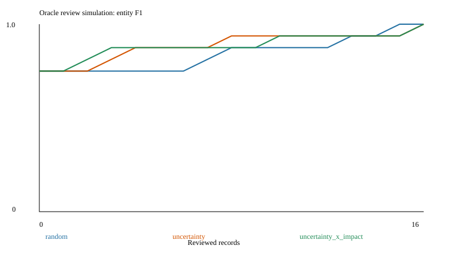
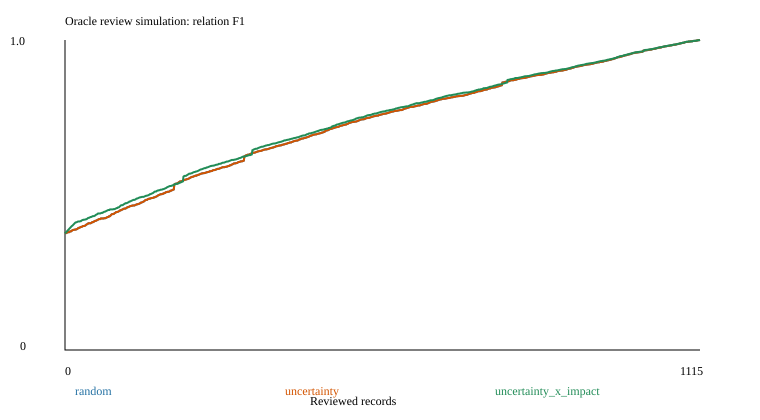

# B48 本体与规则评测

## 验收状态

B48 工程验收已通过：三种复核选样曲线可演示，固定种子可复现；相关 Docker 冒烟与 B30 本体测试在此前集中验证中为 19 项通过。真实数据对照截至 2026-11-18 已覆盖 BTS（标识符基线 + 零样本本地模型）、MaintIE（本地零样本模型 + 训练集词法基线）、Brick（identity、词法、名称嵌入三种预测器），预测与评分均冻结在仓库内、可离线复算。仍未完成的部分全部需要外部输入：plastering 数据许可、政策影响独立标注、三路线的真实人时与费用记录、B30 连续批次记录、Brick 人工业务核验；这些项目在 Issue #68 中标记为外部阻断，本文不为其补造数值。B30 本身不输出 MaintIE 实体/关系或 BTS Brick 类，故不能列为可对照系统。现有结果不能视作 B30 的产品效果。

## 范围及性质

复核曲线的演示使用 `fixtures/ontology/synthetic.json`，它是手工构造的 **synthetic** 样本和假预测，不是 B30、真实模型或比赛成绩。每次假设复核员把一整条记录的预测纠正为标准答案，包含补回漏检；这是理想复核模拟，不是人时测量。三组使用同一批记录和预算，随机排序及排序同分时的次序由种子决定；不预设影响面组最佳。

运行环境：Python 3.11/3.12；下列命令在仓库根目录执行，不调用模型、不产生模型费用：

```sh
python -m plantkg.evaluation.ontology fixtures/ontology/synthetic.json --seed 42 --output /tmp/b48-demo
```

输出 `results.json`、`review.svg`。输出目录必须不存在，防止覆盖已有实验。`run_id`、数据性质、输入 SHA-256 和种子与指标一起记录。输入 SHA-256 按 UTF-8 文本、LF 归一化后计算（`fixtures/ontology/**` 已声明 `text eol=lf`），Windows 与 Linux 检出得到同一值；合成演示的输入哈希为 `0f2116bc7f033de1a8a7b6278a5754e652964cd9a32e7f455f363ea36c84285a`。命令可在另一新目录重跑，两个结果文件应相同。

## 数据及规范

### Issue #68 固定版本核验补充（2026-11-16）

固定的 `scheme.json` SHA-256 为 `0352bd240953829105d3017caf72dbf008e9c2ceee201add1ade22d818b582c0`；其 `entity` 和 `relation` 顶层分别为五类。关系为 `isA`、`contains`、`hasPart`、`hasParticipant`、`hasProperty`；任务指南的“六类顶层关系”与该固定版本不一致。本实现按固定方案报告五类，不自行创造第六类。固定 gold 共 1,076 条，seed 42 的 test 划分为 216 条；按当前 `FACTORY_PATTERN` 工厂关键词匹配，全库 174 条，其中 test 35 条。任务卡“工厂相关约 240 条”为早期预估，不是此固定规则的实际分母；验收与指标均以固定方案和 test 的 35 条为准。预测文件结构见 [JSON Schema](../../plantkg/evaluation/ontology/maintie-predictions.schema.json)；MaintIE 评分还会校验标签、半开 token 区间、关系索引和有限的非负复核权重，预测缺失或无效时报错。校验仅依赖文本 token 和公开标签定义，不以金标生成预测。对未出现的合法类别也按既有零分母约定报告。

D54 报表可接收逐批独立记录的 `document_count` 和实际 `review_minutes`，报告 `review_minutes_per_100_documents` 及累计资料数；未提供时为 null，候选数指标仅作历史对照。累计资料数假定各批资料不重复，必须由记录提供方保证。该入口本身不代表已取得真实人工数据。

本次复跑使用上述固定版本，种子 42：BTS 既有 identifier-only 基线两次生成的预测 SHA-256 均为 `443f1a1e787311f2d7ee7d5c57b557922bab58e2ab9e1212c7a2465305c30148`，结果文件哈希也一致；关系 TP/FP/FN 为 300/0/996，P/R/F1 为 1/0.23148/0.37594。它既不是独立的新模型预测，也没有概念预测。B30 MaintIE 探针测试集 216 条、工厂子集 35 条均输出 0 条规则候选，实体及关系抽取不支持，不能据此计算 F1。数据下载和探针命令见下节；本机结果保存在仓库外，不包含人工计时或付费调用。

三路线采集可用 `python -m plantkg.evaluation.ontology.study <记录.json> --output <新文件.json>` 校验并保留以下字段；三条路线要处理相同的资料批次和质量判据，并由实际参与者填写记录。此入口不自行证明三路线条件相同，也不生成缺失数值：

```json
[{"route":"human", "batch_id":"待填写", "source_sha256":"待填写", "started_at":null, "ended_at":null, "human_minutes":null, "wall_seconds":null, "tokens":null, "api_fee":null, "fee_evidence":null, "accuracy":null, "outcome":null}]
```

政策影响评测入口为 `python -m plantkg.evaluation.ontology.policy_impact <独立标注.json> <冻结预测.json> --output <新文件.json>`。标注记录格式为 `[{"change_id":"待填写", "annotator":"待填写", "affected_rule_ids":[]}]`，预测为 `[{"change_id":"待填写", "affected_rule_ids":[]}]`。实际标注尚未取得时，标注文件使用 `[]`，结果为 `pending_annotation` 和 null 召回率；空数组不是负样本的替代品。标注须由独立人员依据政策原文与规则完成，不能复制算法预测。

可复核候选样本为仓库已有 `fixtures/packs/tariff/jiangsu_2025_426.yaml` 及其引用的政策原件、`fixtures/packs/tariff/jiangsu_pre2025.yaml` 中 `tou-js-pre2025-two-part` 规则。旧版文件明确标记原文和生效日待核，仅有媒体转述；该对照仅供标注准备，不能作为已核实的旧政策真值，也不能把新版规则已获批准解释为影响关系已获独立标注。

本机 Ollama 实验可用 `python -m plantkg.evaluation.ontology.maintie_local <仓库外gold_release.json> --model <本机模型名> --seed 42 --output <仓库外新目录>`。提示词只发送 token 和公开标签；无效输出保存在 `failures.json`，不会自动补为空预测。只有全部测试样本通过格式检查才产生完整 `predictions.json`，之后再运行下方评分命令。模型实际来源、许可证和摘要应从本机服务元数据核对并随实验记录；本地 API 费为零不等于总成本为零。

新生成的预测和评分证据统一采用 `hash_file` 的 UTF-8 / BOM 去除 / CRLF、CR 转 LF 的文本 SHA-256（`hash_scheme=utf8-lf-v1`），输出明确写为 LF。`--run-metadata` 对旧记录继续兼容原始字节 SHA-256（未声明 `hash_scheme` 时），但旧 raw 哈希在文本换行被转换后无法证明其原字节身份，不能假称跨平台匹配。历史冻结证据不改写。

条件修复前会查询本地 Ollama，并要求当前模型 digest 与第一阶段元数据中的 digest 一致；缺少 digest、模型不匹配或服务不可访问时停止，不发起推理。新运行分别记录两阶段推理请求次数（含失败请求，不含模型信息查询）和耗时；旧记录没有请求次数时保留 null。历史记录即使缺少 digest，仍可用现有独立评分入口读取，不能因此补称两阶段模型已验证一致。

2026-11-16 首次无重试实测：本地 Ollama `qwen3.5:4b-q4_K_M`，服务报告模型摘要 `d8b0f5e9760cd1682034f292d7ef72ec46f432149be0df7574bf2d6e92e38c04`、Qwen 3.5 4B、Q4_K_M、Apache-2.0。测试集 216 条中 105 条有效、111 条无效（107 条关系索引、3 条关系标签、1 条跨度）；耗时 607.31 秒。没有完整预测文件或全集 F1。实验原始响应和错误保存在仓库外 `E:/PlantKG/outputs/issue68-maintie-local-20261116/`（本机路径，仅供本机复核）。此轮是验证前版本的单次预测，之后工具加入不使用金标的格式纠错重试；两轮须分开记录。本地 API 费用为 0，机器成本未计量。

- MaintIE：Bikaun 等，[LREC-COLING 2024](https://aclanthology.org/2024.lrec-main.954/)，[原始数据](https://github.com/nlp-tlp/maintie)，MIT，固定提交 `825e7710e4129598da997276a38b3cb40b200bc2`。gold 1,076 条，英文，以矿山车队为主；它不是中文工厂工单。完整原文和方案存仓库外，许可和前 50 条供离线冒烟在 `fixtures/ontology/maintie/`。原文 SHA-256 `ef811cf4ffd0c90e6a13b1369e24e9d1d08f9a294d873ab4fb1a580096d7d6e0`，方案 `0352bd240953829105d3017caf72dbf008e9c2ceee201add1ade22d818b582c0`。重新获取：`python scripts/data/fetch_maintie.py <仓库外新目录>`。
- 按原始零基索引与种子 SHA-256 散列分 70%/10%/20% 为 train/validation/test，避免受输入迭代顺序与全局随机状态影响。工厂相关子集为英文词项的启发式代理：air conditioner/conditioning、hvac、ventilat*、pump*、compressor*、electric*、motor*、lift*、hoist*，并非人工判定；筛选应用于同一划分。
- plastering：[上游说明](https://github.com/plastering/plastering)称 UCSD 未批准公开分享真实楼宇数据，签署协议的流程仍在开发；其公开示例是合成数据，本次未冒充真实评测。2026-11-16 查询时未看到可用的正式申请流程，尚未发出数据申请。
- BTS：上游 [DIEF_BTS](https://github.com/cruiseresearchgroup/DIEF_BTS)，固定提交 `ad1f0d4a6a7405b066fa9470e161cbc3b40e2833` 的 `Site_B.ttl`，项目 MIT。仅涉及该公开单站图，不代表全部建筑或时间序列。SHA-256 `770cc0ddadf6ce7df25963b7d4e9ff1c2840947152f5e27f6e4db8fde9bdf83f`。
- Brick：上游 [Brick 1.2.1](https://github.com/BrickSchema/Brick/releases/tag/v1.2.1) 与 [1.4.0](https://github.com/BrickSchema/Brick/releases/tag/v1.4.0)，BSD-3-Clause；SHA-256 分别为 `7df37f49d7933ae9cc73dc3e1fbc18e78954c41e35899bd5da8ea47c0a6d6841`、`d336095f4cc24bbdee63ba414bb12f46dd6450f718cbe8a4b3c9be23fc26f620`。使用 `python -m plantkg.evaluation.ontology.real_data fetch <仓库外新目录>` 获取并校验三个固定文件；Brick 下载需要 GitHub CLI。

精确匹配以记录 ID 加实体 token 起止位置及顶层类为键；关系以有向头实体、顶层关系类、尾实体为键；完全一致才算命中，同一键去重。微平均 P=TP/(TP+FP)、R=TP/(TP+FN)、F1 为二者调和平均；分母为零记 0。每类同口径。预测必须与标准答案使用同一 offset、标签层级和实体索引；缺失预测会报错，不会视作预测为空。评分入口读取独立准备的预测文件，不调用模型；上述本地模型生成入口单独运行。

分类型 `sample_count` 指该类在 gold 或预测中至少出现一次的记录数（BTS 使用主体数），不等同于该类的三元组数；总体 `items` 为纳入评分的全部记录数。

MaintIE 可接收以原始索引为键、实体和关系格式与金标一致的预测 JSON；每条预测还须包含 `uncertainty` 和 `impact`（从预测/独立上下文取得，禁止从金标取得）：

```sh
python -m plantkg.evaluation.ontology <仓库外目录>/gold_release.json --maintie-predictions <预测文件.json> --split test --seed 42 --output /tmp/b48-maintie-full
python -m plantkg.evaluation.ontology <仓库外目录>/gold_release.json --maintie-predictions <预测文件.json> --split test --factory-only --seed 42 --output /tmp/b48-maintie-factory
```

## 合成演示结果



固定种子 42，16 条 synthetic 记录，复核前 P/R/F1 均为 0.75。复核 8 条时：随机 0.875、不确定性 0.9375、不确定性 × 影响面 0.875；复核全部后均为 1。这里的结果只反映手工构造的数据，不能推广为真实收益。该样本没有关系，关系 P/R/F1 为零分母约定值 0。完整数据见 [结果 JSON](../../plantkg/evaluation/ontology/demo_output/results.json)。

## 真实数据上的已运行实验

### BTS 标识符启发式基线

Site B 图经解析有 1,115 个具 Brick 类型的主体和 1,296 条四类有向关系：isPointOf 894、isPartOf 194、feeds 173、hasLocation 35。这里只使用显式断言，不做推理或逆关系补全。[数据清点](../../plantkg/evaluation/ontology/real_results/bts-inventory.json)。

本基线不是 B30，也不是 LLM：以所有 RDF 主体的匿名标识符作为输入，不读取类型和边；若井号后的标识符至少三段、首段对应另一主体，则预测 isPointOf 指向该主体。标识符格式在看过数据后设计，整张 Site B 图用于探索性评估，没有独立盲测，因此不能推广到其他楼宇。总共预测 300 条，关系微平均 P=1.0000、R=0.2315、F1=0.3759。其余关系均不预测：

| 关系 | TP / FP / FN | Precision | Recall | F1 |
| --- | --- | ---: | ---: | ---: |
| isPointOf | 300 / 0 / 594 | 1.0000 | 0.3356 | 0.5025 |
| isPartOf | 0 / 0 / 194 | 0 | 0 | 0 |
| feeds | 0 / 0 / 173 | 0 | 0 | 0 |
| hasLocation | 0 / 0 / 35 | 0 | 0 | 0 |



[完整输出与每预算点](../../plantkg/evaluation/ontology/real_results/bts-id-baseline/results.json)；[冻结预测](../../plantkg/evaluation/ontology/real_results/bts-id-baseline/prediction.nt)，SHA-256 `443f1a1e787311f2d7ee7d5c57b557922bab58e2ab9e1212c7a2465305c30148`（LF 规范化）。每次理想复核用金标纠正该主体所有关系，非真人复核。种子 42；没有概率模型，故不确定性统一设 1，第二组与随机组相同；影响面为预测子节点数加 1。复核 100 条时三组 F1 分别为 0.4525、0.4525、0.4672，此观察不能证明影响面方法有效。

```sh
python -m plantkg.evaluation.ontology.bts_baseline <数据目录>/bts/Site_B.ttl --seed 42 --output /tmp/bts-result
python -m plantkg.evaluation.ontology.real_data bts <数据目录>/bts/Site_B.ttl /tmp/bts-result/prediction.nt --unsupported-concepts
```

后一个命令还可评测独立提供的任意 RDF 预测，按 URI、类别或有向三元组精确匹配并去重，列出四种关系的 P/R/F1。概念层须提供独立预测，本启发式未做概念预测；不能将图中的标准类型当作预测。

### BTS 零样本本地模型

2026-11-18 增加 `bts_llm`：本机 `qwen3.5:4b-q4_K_M`（服务报告摘要 `d8b0f5e9760cd1682034f292d7ef72ec46f432149be0df7574bf2d6e92e38c04`，Qwen 3.5 4B、Q4_K_M）对同一份固定 `Site_B.ttl` 做零样本预测，不读取金标。输入只含可观察信息：标识符深度、非关系类谓词的本地名、字面量值（如 `DEG_C`）；`rdf:type`、四类目标关系及其逆向关系（`isFedBy`、`hasPart`、`isLocationOf`）在构造提示词前全部剔除。概念任务是 112 类闭集（该数据集出现的 Brick 类），关系任务是"给定已断言实体对、只判断关系类型"的四分类；两种任务分别批量完成，短别名 `c0..`／`r0..` 代替长 URI 以控制 token，别名映射不进入提示词。

协议：种子 42，按 `sha256(seed:key)` 排序抽取 150 个主体和 200 条已断言关系对；温度 0、JSON 模式、`num_ctx` 8192、每批 12 条、最多 1 次有依据重试。本次共 30 个批次、34 次本机请求（其中 4 次是有依据的格式重试，全部在第二次通过），墙钟 202.33 秒，最终 0 条失败项，本地 API 费用 0。**未使用时间序列**：完整数据集 18.77 GB 未下载，因此这是"图上下文 + 标识符"视角，不含任务卡所述时序数值视角。

| 任务 | 样本 | TP / FP / FN | Precision | Recall | F1 |
| --- | ---: | --- | ---: | ---: | ---: |
| 概念（112 类闭集） | 150 | 8 / 142 / 142 | 0.0533 | 0.0533 | 0.0533 |
| 关系（四分类，给定实体对） | 200 | 27 / 173 / 173 | 0.1350 | 0.1350 | 0.1350 |

关系分类型：isPointOf 2/3/136（F1 0.0280）、isPartOf 24/61/6（F1 0.4174）、feeds 1/94/26（F1 0.0164）、hasLocation 0/15/5（F1 0）。概念只有 `Point` 与 `Building_Electrical_Meter` 两类出现过正确命中；模型对匿名图上的绝大多数主体只能猜中父类或猜错叶类。作为同口径参照，同一 200 对上的"父标识符"规则（非模型）得到 55/0/145，P 1.0、R 0.275、F1 0.4314；标识符结构比该零样本模型更有判别力，这与 BTS 数据的匿名化程度一致，不构成对 B30 或任何产品能力的评价。

[冻结概念预测](../../plantkg/evaluation/ontology/real_results/bts-llm-issue68/concept.nt) SHA-256 `d7cf35a3b511b36b8c3c7d0125ac7758bac5bcf65ac7c0e86b592bb6d8aa2057`，[冻结关系预测](../../plantkg/evaluation/ontology/real_results/bts-llm-issue68/relations.nt) SHA-256 `1839712cbd031341a0e68075262b124f3f23d5a18f2c7b0b4df2d296bcefcf5e`，[完整结果](../../plantkg/evaluation/ontology/real_results/bts-llm-issue68/results.json)、[概念复核曲线](../../plantkg/evaluation/ontology/real_results/bts-llm-issue68/entity-review.svg)、[关系复核曲线](../../plantkg/evaluation/ontology/real_results/bts-llm-issue68/relation-review.svg)一并冻结。本地模型即使温度 0 也不保证逐字节复现：同命令两次运行关系预测哈希一致，概念命中数一次为 9、一次为 8，故只冻结本次产物并如实记录该差异。

复核权重来自模型自报置信度（`uncertainty` = 1 − 置信度，`impact` = 1 + 预测实体数与关系数）。复核 50 条时实体 F1：随机 0.3600、仅不确定性 0.3733、不确定性×影响面 0.3733；关系 F1 分别为 0.3793、0.4138、0.6207。三组排序在 151 个预算点中互有差异（不确定性与乘积组有 143 点不同），但这是 oracle 复核模拟，置信度未经校准，不能当作人审收益或分诊有效性的证据。

```sh
python -m plantkg.evaluation.ontology.bts_llm <数据目录>/bts/Site_B.ttl --model qwen3.5:4b-q4_K_M --seed 42 --subjects 150 --pairs 200 --batch-size 12 --output <仓库外新目录>
```

输出目录自动创建并逐批写入 `progress.json`，中断后同一命令可从已完成批次继续；`results.json`、`concept.nt`、`relations.nt` 与两张曲线图在结束时写出。B30 没有 Brick 类或四关系输出接口，无法在 BTS 上计算同口径 F1，故未列入对照。

### Brick 迁移

2026-11-16 增加 `lexical` 算法基线：仅根据旧/新类名与弃用标记，使用 Python `difflib.SequenceMatcher` 选择词面最相似的非弃用新类；不读取 `isReplacedBy` 断言作为输入。对 175 个旧版弃用项生成预测，并仅以新版带替代注记的 143 项作为声明参考答案评分：正确 7、错误 136、遗漏 0，准确率 0.04895。两次独立生成的预测文件 SHA-256（LF 规范化）均为 `47cb7422e49398ff54e650a10c8efc579dfef44cf046147e1d53aaa6e7da33e9`；第二次命令墙钟约 8.47 秒，确定性算法无需种子、无模型 API 费用，机器成本未计量。[冻结预测](../../plantkg/evaluation/ontology/real_results/brick-lexical-issue68.json)可用于独立重算；逐项评分本机留在仓库外 `E:/PlantKG/outputs/issue68-brick-lexical-20261116/`。该分数只对照新版声明，尚无人工独立核验，不代表 PlantKG 模型能力。

2026-11-18 增加第二个独立预测器 `brick_embedding`：用本机 `plantkg-qwen3-embedding:0.6b-q8`（服务报告摘要 `8b752ab34efb5f17a84567801ec213e5d2c2da504b5501775cec3588258cc13d`，Qwen3-Embedding-0.6B、Q8_0、1024 维）对类名（去命名空间、下划线转空格、小写）做嵌入，在 1,252 个非弃用 `owl:Class` 候选中取余弦最相似者，同样不读取 `isReplacedBy`。对 143 个带声明替代的项：正确 11、错误 132、遗漏 0，准确率 0.0769；预测文件 SHA-256（LF 规范化）`2f0f517fff23f33ca1ccd095c1594bdc60c4dd9acedbc3b440d6b1b7d72e8715`，[冻结预测](../../plantkg/evaluation/ontology/real_results/brick-embedding-issue68.json)与[逐项评分](../../plantkg/evaluation/ontology/real_results/brick-embedding-eval.json)均在仓库内，可离线复算。本机墙钟约 256.8 秒（约 1,427 条文本嵌入，含候选类），本地 API 费用 0，机器成本未计量。

| 独立预测器 | 正确 / 143 | 准确率 | 依据 |
| --- | ---: | ---: | --- |
| identity（原样保留） | 0 | 0 | 不看新版 |
| 词面相似 `difflib` | 7 | 0.04895 | 名称 + 弃用标记 |
| 名称嵌入余弦 | 11 | 0.0769 | 名称 + 本地嵌入模型 |

三者都只对照新版 `isReplacedBy` 声明：名称信息无法恢复大部分替代关系，且声明本身不是人工独立核验的业务映射。因此迁移评测的"声明映射 / 实际预测 / 人工核验"三层中，前两层已有可复算证据，人工核验仍缺失。

```sh
python -m plantkg.evaluation.ontology.brick_lexical <旧版.ttl> <新版.ttl> --output <仓库外新目录>/predictions.json
python -m plantkg.evaluation.ontology.real_data brick <旧版.ttl> <新版.ttl> <仓库外新目录>/predictions.json
python -m plantkg.evaluation.ontology.brick_embedding <旧版.ttl> <新版.ttl> --output <仓库外新目录2>/predictions.json
python -m plantkg.evaluation.ontology.real_data brick <旧版.ttl> <新版.ttl> <仓库外新目录2>/predictions.json
```

两个发行版实际解析中，在 1.2.1 出现、1.4.0 用 `owl:deprecated true` 标记的 Brick 命名空间项为 175，其中 143 个带 `brick:isReplacedBy`。不看新版、对旧项原样保留的独立 identity 基线，143 项正确 0、错误 143、遗漏 0，准确率 0；见[逐项结果](../../plantkg/evaluation/ontology/real_results/brick-identity.json)。未带替代注记的 32 项不纳入映射准确率分母，也不等同于可删除。该基线用于展示必须处理弃用，不代表 PlantKG 的迁移结果。新版本声明作为参考答案，不是人工独立验证的业务映射。

```sh
python -m plantkg.evaluation.ontology.real_data brick-identity <数据目录>/brick-1.2.1/Brick.ttl <数据目录>/brick-1.4.0/Brick.ttl
python -m plantkg.evaluation.ontology.real_data brick <旧版.ttl> <新版.ttl> <独立预测映射.json>
```

### MaintIE 与 B30 能力探针

#### 本地模型：格式校验与条件修复后的实验

在固定 test 的 216 条上，本机 `qwen3.5:4b-q4_K_M` 以种子 42、温度 0 生成实体和关系。首次两次重试后 181 条有效、35 条的关系索引仍无效；随后对这 35 条保留模型已输出的有效实体，以相同模型名称在限定实体索引范围的 JSON Schema 下重新生成关系。当时的两阶段记录没有可供比较的模型 digest，实际模型版本是否一致未获验证；文中模型摘要是当时对本机服务元数据的查询结果，不是两阶段一致性证明。提示词与格式反馈均不含金标。这是**两阶段条件修复**结果：复用本轮已记录响应，不能称为单次无修复调用，也不与其他算法混为一组。历史 `metadata.json` 的预测文件原始字节 SHA-256 为 `a45124658b12d7abc62fc6aad740ba8665acd907116db0fdf936ebf758a4c8c9`（Windows CRLF），而 `full.json`/`factory.json` 评分字段 `predictions_sha256` 为 `8ada1a508115dac41c24e595d3d57b82af7e142cae297c0cb0c5707be6383fe8`（LF 规范化）；两者指向同一份历史预测内容、哈希口径不同，新运行已统一，未重新生成该历史预测。上一轮原始响应 SHA-256 `bccf765d63116fa51ba7d600e72a69ebde4447d9943527c88d04ff9bea72942`。记录在仓库外 `E:/PlantKG/outputs/issue68-maintie-local-retry-20261116/` 与 `E:/PlantKG/outputs/issue68-maintie-local-repair-20261116/`。共 404 次本机请求、提示 62,747 token、生成 54,432 token；首阶段墙钟 876.42 秒，修复阶段 40.06 秒，本地 API 费用 0，机器及人工成本未计量。固定预测的评分重复运行结果 SHA-256 相同；这只证明评分可重复，不证明重新推理的预测逐字节一致。

| 数据 | 样本数 | 类别 | TP / FP / FN | Precision | Recall | F1 |
| --- | ---: | --- | --- | ---: | ---: | ---: |
| test 全集 | 216 | 实体 | 152 / 248 / 552 | 0.3800 | 0.2159 | 0.2754 |
| test 全集 | 216 | 关系 | 6 / 186 / 483 | 0.0313 | 0.0123 | 0.0176 |
| 同一 test 的关键词工厂子集 | 35 | 实体 | 23 / 49 / 98 | 0.3194 | 0.1901 | 0.2383 |
| 同一 test 的关键词工厂子集 | 35 | 关系 | 0 / 34 / 87 | 0 | 0 | 0 |

按类的 P/R/F1、TP/FP/FN、样本数和每预算点见[全集结果](../../plantkg/evaluation/ontology/real_results/maintie-adaptive-issue68/full.json)与[工厂子集结果](../../plantkg/evaluation/ontology/real_results/maintie-adaptive-issue68/factory.json)。[实体复核曲线](../../plantkg/evaluation/ontology/real_results/maintie-adaptive-issue68/entity-review.svg)和[关系复核曲线](../../plantkg/evaluation/ontology/real_results/maintie-adaptive-issue68/relation-review.svg)均为 oracle simulation，假定复核直接修正金标差异，不表示真实人审效率。**本次 MaintIE 本地模型未提供可校准的不确定性和独立影响面分数，生成器将所有预测的 `uncertainty` 与 `impact` 均设为 1，三种复核选样顺序（随机、仅不确定性、不确定性×影响面）在实体与关系两种 F1 曲线上均逐点完全重合；影响面选样在本实验中无效，不能算三组有区分度的对照或收益证据。**只有以后取得独立的预测侧信号，才可进行真实三组选样对比。该结果不等于 B30 的能力；与支持同一输出格式的第二个系统的对照见下节（监督式词法基线，非同等训练条件）。

```sh
python -m plantkg.evaluation.ontology.maintie_local <仓库外gold_release.json> --model qwen3.5:4b-q4_K_M --seed 42 --output <仓库外新目录1>
python -m plantkg.evaluation.ontology.maintie_repair <仓库外gold_release.json> <仓库外新目录1> --output <仓库外新目录2>
python -m plantkg.evaluation.ontology <仓库外gold_release.json> --maintie-predictions <仓库外新目录2>/predictions.json --run-metadata <仓库外新目录2>/metadata.json --split test --seed 42 --output <仓库外新目录3>
python -m plantkg.evaluation.ontology <仓库外gold_release.json> --maintie-predictions <仓库外新目录2>/predictions.json --run-metadata <仓库外新目录2>/metadata.json --split test --factory-only --seed 42 --output <仓库外新目录4>
```

通过注册表加载 B30 的 `RuleExtractor`，把 seed=42 测试划分的 216 条英文文本作为片段输入（无金标输入），实际返回 0 条规则候选；相同测试划分的工厂关键词子集 35 条，返回 0 条。测得提取循环耗时约 0.0043 秒，仅反映本次环境下中文模板未命中，非模型调用、人审或构建效率指标。见[运行记录](../../plantkg/evaluation/ontology/real_results/maintie-b30-probe-v2.json)。B30 返回 `RuleCandidate`，没有 MaintIE 实体 token 范围及关系抽取输出，无法据此计算实体/关系 F1，因此不作为适用系统列入对照，也不以空预测记分。

```sh
python -m plantkg.evaluation.ontology.maintie_b30 <仓库外目录>/gold_release.json --split test --seed 42 --output /tmp/maintie-b30.json
```


#### 训练集词法基线：第二个适用系统

`maintie_lexicon` 只用 seed 42 的 train 划分（758 条）学习：小写 token 的表面词表（761 个短语，最长 4 token）和（头实体类, 尾实体类）→关系类型的先验（11 组），再对 test 的 216 条输出与本地模型同一 schema、同一评分入口的实体与关系预测。它是**监督式**基线（读取 train 标签），本地模型是零样本；表格并列只说明"存在一个支持该输出格式的适用系统"，两者训练条件不同，不能解读为同等条件下的算法优劣。每次预测都与金标格式一起校验通过。

| 评测集 | 样本数 | 类别 | 系统 | TP / FP / FN | Precision | Recall | F1 |
| --- | ---: | --- | --- | --- | ---: | ---: | ---: |
| test 全集 | 216 | 实体 | 训练集词法 | 527 / 67 / 177 | 0.8872 | 0.7486 | 0.8120 |
| test 全集 | 216 | 实体 | 本地零样本 LLM（两阶段条件修复） | 152 / 248 / 552 | 0.3800 | 0.2159 | 0.2754 |
| test 全集 | 216 | 关系 | 训练集词法 | 139 / 145 / 350 | 0.4894 | 0.2843 | 0.3596 |
| test 全集 | 216 | 关系 | 本地零样本 LLM（两阶段条件修复） | 6 / 186 / 483 | 0.0313 | 0.0123 | 0.0176 |
| 同一 test 的关键词工厂子集 | 35 | 实体 | 训练集词法 | 97 / 10 / 24 | 0.9065 | 0.8017 | 0.8509 |
| 同一 test 的关键词工厂子集 | 35 | 关系 | 训练集词法 | 30 / 29 / 57 | 0.5085 | 0.3448 | 0.4110 |

按类 F1（全集实体）：Activity 0.8968、PhysicalObject 0.7629、Process 0.9444、Property 0.8696、State 0.8050；关系：hasPart 0.5566、hasParticipant 0.3415、hasProperty 0.3333、contains 0、isA 0。预测文件 SHA-256（LF 规范化）`edcc3c45ae0713771d38c2ec196f2dd5baddda086402fa94b8a3a837aea41f78`，216 条，与 `run_metadata` 记录的 `prediction_sha256`、`source_sha256` 和种子 42 一致；[冻结预测](../../plantkg/evaluation/ontology/real_results/maintie-lexicon-issue68/predictions.json)、[元数据](../../plantkg/evaluation/ontology/real_results/maintie-lexicon-issue68/metadata.json)、[全集结果](../../plantkg/evaluation/ontology/real_results/maintie-lexicon-issue68/full.json)与[工厂子集结果](../../plantkg/evaluation/ontology/real_results/maintie-lexicon-issue68/factory.json)均在仓库内。确定性算法无模型调用、API 费用 0，机器成本未计量。

本基线的复核权重来自预测侧：`uncertainty` = 1 − 匹配表面在训练集中该标签占比的均值，`impact` = 预测实体覆盖的 token 数。复核 50 条时实体 F1：随机 0.8610、仅不确定性 0.8625、不确定性×影响面 0.8625；[实体曲线](../../plantkg/evaluation/ontology/real_results/maintie-lexicon-issue68/entity-review.svg)。不确定性排序与随机排序有 197 个预算点不同，但增益极小；不确定性与"不确定性×影响面"在 217 个预算点中只有 1 点不同，即**影响面在本基线上不改变选样顺序**。这些都是 oracle 复核模拟，不作分诊收益结论。

```sh
python -m plantkg.evaluation.ontology.maintie_lexicon <仓库外gold_release.json> --seed 42 --output <仓库外新目录>
python -m plantkg.evaluation.ontology <仓库外gold_release.json> --maintie-predictions <新目录>/predictions.json --run-metadata <新目录>/metadata.json --split test --seed 42 --output <仓库外新目录2>
python -m plantkg.evaluation.ontology <仓库外gold_release.json> --maintie-predictions <新目录>/predictions.json --run-metadata <新目录>/metadata.json --split test --factory-only --seed 42 --output <仓库外新目录3>
```

### D54 批次统计入口

`python -m plantkg.evaluation.ontology.batch_report <B30数据库> --plant-id <厂区> --output /tmp/b30-trends` 以只读方式读取 `b30_batches`；也可读取 B30 导出的 JSON 数组。输出批次 JSON 与趋势 SVG，缺失准确率和成本为 null、图中断线。B30 的 items 是**候选数**，其每百条分钟的分母是候选而非资料；只有补充资料数量与准确率的真实记录后才能评价原目标。当前没有已核验真实连续批次，不作“越学越省”结论。

仓库冻结文本文件位于 `plantkg/evaluation/ontology/real_results/**`，已声明 `text eol=lf`。文档中对冻结预测的 SHA-256 采用 LF 规范化值；旧 Windows 工作副本若在属性生效前按 CRLF 检出，直接对磁盘字节取 SHA 会不同，但这不代表预测内容不同。

## 尚未测量与限制

- plastering 原始数据未公开；上游称 UCSD 未批准公开分享真实楼宇数据，申请流程尚未提供，本次未提交申请，也未用 synthetic 示例冒充真实评测。
- BTS 已运行标识符基线与本地零样本模型（图上下文 + 标识符视角）；时间序列视角未测：完整数据集 18.77 GB 未下载。B30 不输出 Brick 类或四关系，无法计算同口径 F1，故不作为对照系统。
- MaintIE 已运行本地零样本模型与训练集词法基线；两者训练条件不同（零样本 vs 监督），不能读作算法优劣。另一个具备同等输出的零样本系统未找到，未发起任何付费云调用。
- Brick 已用 identity、词法、名称嵌入三种预测器对照 1.4.0 声明；人工独立业务核验缺失，声明本身不等于核验后的映射。
- 政策版本变化的受影响规则召回缺独立标注；纯人工、纯 LLM、PlantKG 的实际人审分钟、token、费用及准确率对照未测量。B30 模拟演示不是实际人时记录。
- 所有本地模型实验的 API 费用为 0，机器与人工成本未计量；模型即使温度 0 也不保证逐字节复现（BTS 概念命中一次为 9、一次为 8），已冻结的预测与哈希对应本机某一次运行。
